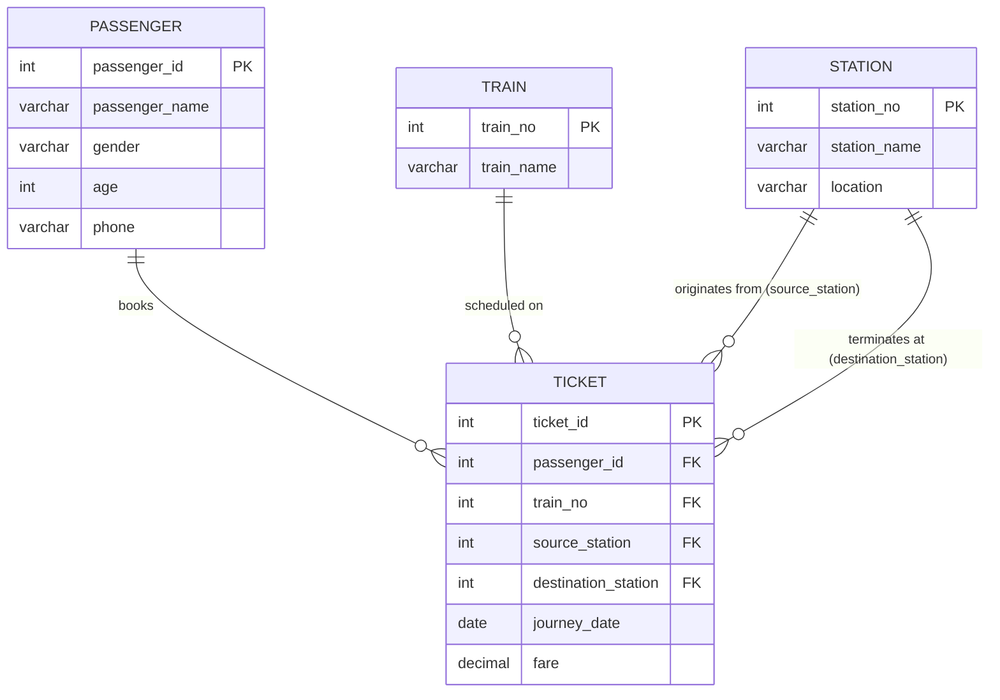

# RailConnect – Database Design Document

> **Project Name:** RailConnect – Railway Reservation Management System  
> **Course:** Database Management Systems (DBMS)  
> **Database Engine:** MySQL InnoDB  
> **Character Set:** `utf8mb4`  

---

## 1. Entity-Relationship (ER) Diagram

### ASCII Diagram

```text
       +--------------------+
       |     PASSENGER      |
       +--------------------+
       | PK passenger_id    |
       |    passenger_name  |
       |    gender          |
       |    age             |
       |    phone           |
       +---------+----------+
                 | 1
                 |
                 | books
                 |
                 | N
       +---------v----------+            N +--------------------+
       |       TICKET       | >------------|       TRAIN        |
       +--------------------+   scheduled  +--------------------+
       | PK ticket_id       |      on      | PK train_no        |
       | FK passenger_id    |              |    train_name      |
       | FK train_no        |              +--------------------+
       | FK source_station  |
       | FK dest_station    |
       |    journey_date    |
       |    fare            |
       +---------+----------+
                 |
                 | departs / arrives (N)
                 |
                 v 1
       +--------------------+
       |      STATION       |
       +--------------------+
       | PK station_no      |
       |    station_name    |
       |    location        |
       +--------------------+
```

### Mermaid Diagram



---

## 2. Relational Schema

1. **Passenger** (`passenger_id`, `passenger_name`, `gender`, `age`, `phone`)
2. **Train** (`train_no`, `train_name`)
3. **Station** (`station_no`, `station_name`, `location`)
4. **Ticket** (`ticket_id`, `passenger_id`, `train_no`, `source_station`, `destination_station`, `journey_date`, `fare`)

---

## 3. Detailed Table Specifications

### Table 1: `Passenger`
Stores demographic and contact details of passengers.

| Column Name | Data Type | Constraints | Description |
| :--- | :--- | :--- | :--- |
| `passenger_id` | `INT` | `PRIMARY KEY`, `AUTO_INCREMENT` | Unique identifier for each passenger |
| `passenger_name` | `VARCHAR(100)` | `NOT NULL` | Full name of the passenger |
| `gender` | `VARCHAR(10)` | `NULL` | Gender (Male, Female, Other) |
| `age` | `INT` | `NULL` | Age in years |
| `phone` | `VARCHAR(15)` | `NULL` | Contact phone number |

---

### Table 2: `Train`
Stores master information of trains operating in the system.

| Column Name | Data Type | Constraints | Description |
| :--- | :--- | :--- | :--- |
| `train_no` | `INT` | `PRIMARY KEY` | Unique 5-digit official train number |
| `train_name` | `VARCHAR(100)` | `NOT NULL` | Commercial name of the train |

---

### Table 3: `Station`
Stores master information of railway stations.

| Column Name | Data Type | Constraints | Description |
| :--- | :--- | :--- | :--- |
| `station_no` | `INT` | `PRIMARY KEY` | Unique numeric code for the station |
| `station_name` | `VARCHAR(100)` | `NOT NULL` | Name of the railway station |
| `location` | `VARCHAR(100)` | `NULL` | City or geographic location |

---

### Table 4: `Ticket`
Stores individual reservation bookings, linking passengers, trains, and route stations.

| Column Name | Data Type | Constraints | Description |
| :--- | :--- | :--- | :--- |
| `ticket_id` | `INT` | `PRIMARY KEY`, `AUTO_INCREMENT` | Unique ticket / PNR identifier |
| `passenger_id` | `INT` | `NOT NULL`, `FOREIGN KEY` | References `Passenger(passenger_id)` |
| `train_no` | `INT` | `NOT NULL`, `FOREIGN KEY` | References `Train(train_no)` |
| `source_station` | `INT` | `NOT NULL`, `FOREIGN KEY` | References `Station(station_no)` |
| `destination_station` | `INT` | `NOT NULL`, `FOREIGN KEY` | References `Station(station_no)` |
| `journey_date` | `DATE` | `NOT NULL` | Scheduled date of journey |
| `fare` | `DECIMAL(10,2)` | `NOT NULL` | Cost of the ticket in INR |

---

## 4. Foreign Key Constraints & Integrity Rules

```sql
FOREIGN KEY (passenger_id) REFERENCES Passenger(passenger_id) 
    ON UPDATE CASCADE ON DELETE RESTRICT

FOREIGN KEY (train_no) REFERENCES Train(train_no) 
    ON UPDATE CASCADE ON DELETE RESTRICT

FOREIGN KEY (source_station) REFERENCES Station(station_no) 
    ON UPDATE CASCADE ON DELETE RESTRICT

FOREIGN KEY (destination_station) REFERENCES Station(station_no) 
    ON UPDATE CASCADE ON DELETE RESTRICT
```

### Referential Integrity Explanation:
- **`ON UPDATE CASCADE`**: If a train number, station code, or passenger ID is updated, changes automatically cascade to related tickets.
- **`ON DELETE RESTRICT`**: Prevents deletion of a parent record (Passenger, Train, or Station) if tickets still reference it. This protects transaction history from orphan records.

---

## 5. Relationships & Cardinality

| Relationship | Cardinality | Business Rule |
| :--- | :--- | :--- |
| **Passenger to Ticket** | `1 : N` (One-to-Many) | One registered passenger can book multiple tickets over time; each ticket belongs to exactly one passenger. |
| **Train to Ticket** | `1 : N` (One-to-Many) | One train can have multiple tickets booked for its journeys; each ticket is booked for a specific train. |
| **Station to Ticket (Source)** | `1 : N` (One-to-Many) | One station can serve as the origin (source) for many ticket journeys. |
| **Station to Ticket (Destination)** | `1 : N` (One-to-Many) | One station can serve as the terminus (destination) for many ticket journeys. |

---

## 6. Normalization Assessment

- **1NF (First Normal Form):** All column attributes contain atomic values (single values). No repeating groups exist.
- **2NF (Second Normal Form):** Tables are in 1NF, and all non-key attributes are fully functionally dependent on the entire primary key (no partial dependencies).
- **3NF (Third Normal Form):** Tables are in 2NF, and no non-key attribute is transitively dependent on any candidate key (no transitive dependencies).
